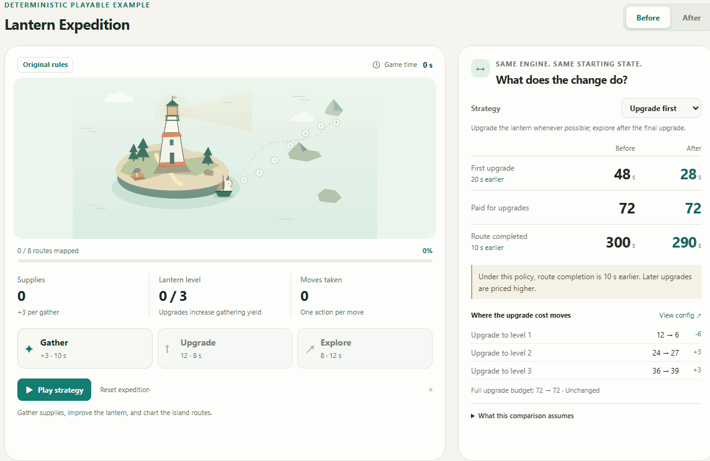

<div align="center">


# Game Design Agents

**Turn a game-design change into a playable result—with the tradeoffs and checks attached.**

A Skill for AI coding assistants. Design the change, update the rules and parameters, then play and verify what changed.

[](package.json) [](https://github.com/yiyiwahmo28-hue/game-design-agents/actions/workflows/ci.yml) [](LICENSE)

[**Play the before & after**](https://yiyiwahmo28-hue.github.io/game-design-agents/) · [Start your game](#start-your-game) · [中文](README.zh-CN.md)

</div>

> “Keep total resource production unchanged. Turn early waiting into a choice that matters.”



*Actual browser captures of the working comparison, edited for length. An original fictional design case, with retained implementation and review. [Capture details](docs/demo.md) · [Full case](docs/runs/signal-camp/README.md).*

## Same resources. Earlier choices.

In **Signal Camp**, the original sells both tools as a bundle. The player must wait three turns before buying it. The revision sells usable modules separately, so the first allocation decides which mission can catch the early window.

| Complete modeled route | People evacuated | Routes mapped | Supplies produced / spent / left |
| --- | ---: | ---: | --- |
| Original: wait for the bundle | 2 | 1 | 6 / 8 / 1 |
| Revised: beacon first | 6 | 1 | 6 / 8 / 1 |
| Revised: survey tools first | 2 | 3 | 6 / 8 / 1 |

All three start with **3 supplies**, receive **+1 after each of 6 turns**, and pay the same total facility and mission costs. The whole income schedule is unchanged. People and routes are mission outcomes, not spendable supplies.

Change the assignment from evacuation to route preparation, and the successful first allocation reverses. The cost is visible too: two waits remain later, separate modules require an extra construction action, and the player must understand the decision sooner. The retained bundle is a dominated comparison route under these objectives.

[Read the diagnosis, rejected alternatives and design costs →](docs/runs/signal-camp/README.md)

## What this workflow does

Changing a rule can leave the design document, parameter table and actual game disagreeing. This Skill tracks the relevant consumers and delivers a result you can inspect and operate.

| You bring | The workflow delivers |
| --- | --- |
| A new gameplay brief | Design decisions, rules, editable parameters and a playable prototype |
| A pacing or balance change | A preserved baseline, alternatives, updated behavior and before/after evidence |
| A result to review | Actual checks, findings, repairs and clearly identified gaps |

Its [pacing-redesign guidance](skills/game-design-team/references/pacing-redesign.md) generalizes the method: freeze the accounting, locate the gate, expose the opportunity cost, test a context that reverses the choice, and show what the redesign costs. It imposes no universal reward curve or ideal session length.

## Start your game

Requires Node.js 22+ and an AI coding assistant that can read files, edit them, and run commands. No dependencies to install for the included tools.

```sh
git clone https://github.com/yiyiwahmo28-hue/game-design-agents.git
cd game-design-agents
npm run new -- --name my-game --brief "Build a small camp game. Preserve total supply production while moving a consequential choice earlier."
```

**Paste the printed prompt into your assistant with this repository open.** It points to the Skill and your new workspace. The command prepares files; your assistant performs the design and implementation using its own model and tools. Follow the generated `START_HERE.md` to inspect the delivery, run it, and request a change.

[Step-by-step guide and expected outputs →](docs/start-your-game.md)

<details>
<summary>Use the Skill in an existing project</summary>

```sh
npx skills add yiyiwahmo28-hue/game-design-agents --skill game-design-team
```

Ask your assistant to use `game-design-team` with your brief or change request. The standalone Skill is self-contained; it does not include this repository's demo or CLI.

</details>

<details>
<summary>Run the published examples locally</summary>

```sh
npm start
```

Open `http://127.0.0.1:4173` for the Signal Camp playable comparison. [Rain Harbor](https://yiyiwahmo28-hue.github.io/game-design-agents/harbor.html) remains at `/harbor.html`. The earlier [Lantern Expedition](https://yiyiwahmo28-hue.github.io/game-design-agents/lantern.html) remains available at `/lantern.html`.

`npm test` runs behavior and tool tests. `npm run audit` executes independent rule oracles. `npm run simulate` regenerates evidence for all three cases; `npm run verify` checks it against the current inputs and engine.

</details>

## Three inspectable cases

| Case | What to inspect |
| --- | --- |
| [Signal Camp](docs/runs/signal-camp/README.md) · [play](https://yiyiwahmo28-hue.github.io/game-design-agents/) | Diagnose a purchase gate, preserve income and prices, move choices earlier, expose the tradeoff |
| [Rain Harbor](docs/runs/rain-harbor/README.md) · [play](https://yiyiwahmo28-hue.github.io/game-design-agents/harbor.html) | Deliver a new brief, then implement one undo without refunding its allowance or changing the economy |
| [Lantern Expedition](docs/example.md) · [play](https://yiyiwahmo28-hue.github.io/game-design-agents/lantern.html) | Explore gathering, investing in efficiency and spending on progress |

Design lead, systems, economy, implementation and review are responsibilities. Use only those the task needs. Real subagents can own separate work; otherwise the assistant applies the roles sequentially and discloses self-review. [Workflow and compatibility](docs/workflow.md).

## Evidence and limits

Each demo shares its rules module with its generated evidence. The retained cases include actual execution and browser observations. Signal Camp's independent oracle examines all legal histories in this small model, including delays and rejected actions. [Release verification](docs/verification.md).

The browser runs examples without an AI backend. Creating a new game requires an assistant; the starter's completeness check only confirms files exist. The examples do not prove reliable generation for arbitrary genres or hosts. Optional Claude Code adapters have not been exercised end to end in Claude Code.

Signal Camp demonstrates allocation between two disclosed objectives. Each objective has a unique successful opening in this small model; it is not a claim of deep strategy. Whether people understand or prefer the redesign remains untested. The [human playtest plan](docs/runs/signal-camp/playtest-plan.md) is explicitly unexecuted. No retention lift or controlled multi-agent superiority is claimed.

## Contribute

Try your own brief and report a concrete failure: the input, expected behavior, actual artifacts, and host used. New reproducible cases and repairs are welcome.

[Contribution guide](CONTRIBUTING.md) · [Open an issue](https://github.com/yiyiwahmo28-hue/game-design-agents/issues) · [Verification](docs/verification.md)

The method draws on game systems design and cross-role delivery. Public examples and instructions are independently authored and contain no employer documents or internal game data. [Claude Code Game Studios](https://github.com/Donchitos/Claude-Code-Game-Studios) inspired the studio direction; this project is independent and unaffiliated. For general requirements writing, see [Write Clear Spec](https://github.com/yiyiwahmo28-hue/write-clear-spec).

## License

[MIT](LICENSE). `private: true` prevents accidental npm publication; the repository is open source.
