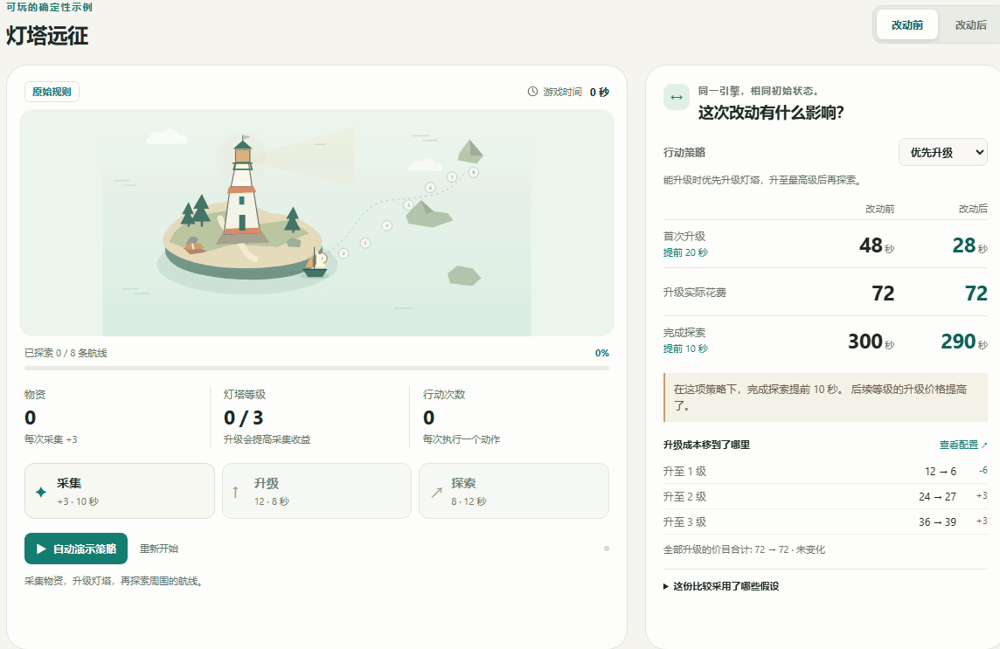

<div align="center">


# Game Design Agents

**让 AI 改玩法时，把规则、数值和可玩原型一起改对。**

面向 AI 编程助手的策划 Skill：解释设计取舍，实际完成修改，交付可以试玩和验证的结果。

[](package.json) [](https://github.com/yiyiwahmo28-hue/game-design-agents/actions/workflows/ci.yml) [](LICENSE)

[**试玩修改前后**](https://yiyiwahmo28-hue.github.io/game-design-agents/?lang=zh) · [开始自己的游戏](#开始自己的游戏) · [English](README.md)

</div>

> “总资源产出不变，让前期等待变成有意义的选择。”



*实际浏览器操作录制，时长经过剪辑。原创虚构案例，保留了真实实现与审查记录。[录制说明](docs/demo.md) · [完整案例](docs/runs/signal-camp/README.md)。*

## 同样的资源，更早的选择

**信标营地**的原版只能整包购买设备，玩家前三回合只能等。改版把整包拆成能够立即使用的模块，让第一笔投入决定哪项任务能赶上早期窗口。

| 完整模拟路线 | 接走人数 | 勘测路线 | 补给产出 / 花费 / 剩余 |
| --- | ---: | ---: | --- |
| 原版：等待整包 | 2 | 1 | 6 / 8 / 1 |
| 改版：先建信标 | 6 | 1 | 6 / 8 / 1 |
| 改版：先建勘测工具 | 2 | 3 | 6 / 8 / 1 |

三条路线都是**初始 3 补给、每回合到账 1、共 6 回合**，完整设备和任务总价相同。连每次到账的时点都保持一致。人数和路线是任务成果，不是可消费补给。

把任务从“优先接走滞留者”换成“优先打通后续路线”，成功所需的第一步就会反转。代价也可见：两次等待移到了中段，分开建设多占一次操作，玩家需要更早理解取舍。保留的整包路线用于对照，在这两个目标下都不是最优选择。

[查看问题诊断、放弃的方案与接受的代价 →](docs/runs/signal-camp/README.md)

## 这套流程解决什么？

一条规则改完，策划案、参数表和实际游戏可能各说各话。这套 Skill 追踪受影响的内容，把设计决定落实到可以运行和检查的结果。

| 你提供什么 | 流程交付什么 |
| --- | --- |
| 新的玩法需求 | 设计取舍、明确规则、可编辑参数、可玩原型 |
| 节奏或数值修改 | 保留的基线、备选方案、更新后的行为、前后证据 |
| 待审查的结果 | 实际检查、发现的问题、修复与尚未验证的部分 |

[通用节奏改稿方法](skills/game-design-team/references/pacing-redesign.md)提炼了这次判断：先定账本口径，定位阻挡选择的条件，说明机会成本，找出会让选择反转的情境，展示改稿代价。不把本例数值、奖励曲线或时长当作通用标准。

## 开始自己的游戏

需要 Node.js 22+，以及能够读写文件、运行命令的 AI 编程助手。仓库自带工具无需安装依赖。

```sh
git clone https://github.com/yiyiwahmo28-hue/game-design-agents.git
cd game-design-agents
npm run new -- --name my-game --brief "做一个小型营地游戏。保持补给总产出不变，让有实际后果的选择更早出现。" --lang zh
```

**在打开这个仓库的 AI 助手中，粘贴命令打印出的提示。** 提示会指向 Skill 和你的新工作区。命令负责准备文件，助手使用已有模型和工具完成设计与实现。随后按生成的 `START_HERE.md` 查看交付物、运行原型，再提出修改。

[逐步教程与预期交付物 →](docs/start-your-game.zh-CN.md)

<details>
<summary>在已有项目中使用 Skill</summary>

```sh
npx skills add yiyiwahmo28-hue/game-design-agents --skill game-design-team
```

请助手使用 `game-design-team` 处理你的需求或修改任务。单独安装的 Skill 自包含，不附带本仓库的 Demo 和命令行工具。

</details>

<details>
<summary>本地运行已发布的案例</summary>

```sh
npm start
```

打开 `http://127.0.0.1:4173`，并排试玩信标营地。[雨港救援](https://yiyiwahmo28-hue.github.io/game-design-agents/harbor.html?lang=zh)保留在 `/harbor.html`。原有[灯塔远征](https://yiyiwahmo28-hue.github.io/game-design-agents/lantern.html?lang=zh)保留在 `/lantern.html`。

`npm test` 检查实际行为和工具；`npm run audit` 执行独立规则审查；`npm run simulate` 重新生成三个案例的证据；`npm run verify` 检查证据是否与当前输入、程序一致。

</details>

## 三个可以检查的案例

| 案例 | 展示重点 |
| --- | --- |
| [信标营地](docs/runs/signal-camp/README.md) · [试玩](https://yiyiwahmo28-hue.github.io/game-design-agents/?lang=zh) | 定位购买门槛，保持收入与价格，前置选择并揭示代价 |
| [雨港救援](docs/runs/rain-harbor/README.md) · [试玩](https://yiyiwahmo28-hue.github.io/game-design-agents/harbor.html?lang=zh) | 从新需求交付原型，再加入一次撤销，保留经济参数和已用额度 |
| [灯塔远征](docs/example.md) · [试玩](https://yiyiwahmo28-hue.github.io/game-design-agents/lantern.html?lang=zh) | 权衡采集、投资效率与直接推进 |

设计负责人、系统策划、数值策划、原型开发和审查是职责划分，按任务启用。能调用子代理时真实委派；否则顺序应用角色并披露自检。[协作与兼容性](docs/workflow.zh-CN.md)。

## 证据与边界

每个 Demo 与对应验证共用规则模块，案例保留了实际执行和浏览器观察。信标营地的独立规则模型检查这个小型系统的全部合法历史，包括拖延和拒绝操作。[发布验证记录](docs/verification.md)。

网页直接运行示例，不带 AI 后端。生成新游戏需要助手；入口完整性检查只确认文件存在。已有案例不能证明任意品类或助手都能稳定交付。可选 Claude Code 角色适配尚未在 Claude Code 中完成端到端验证。

信标营地展示两种已知任务下的资源分配；每个任务在这个小模型里有唯一成功开局，不能据此宣称策略深度。真人能否理解、是否更喜欢仍待测试。[真人试玩计划](docs/runs/signal-camp/playtest-plan.md)明确标记为尚未执行，不编造参与者或留存结论，也不声称多 Agent 已被证明优于单助手。

## 参与改进

用自己的需求试一次，反馈具体失败：输入、预期、实际产物和所用助手。欢迎可复现的新案例、明确的流程缺陷与修复。

[贡献指南](CONTRIBUTING.md) · [反馈问题](https://github.com/yiyiwahmo28-hue/game-design-agents/issues) · [验证记录](docs/verification.md)

方法源于游戏系统策划与跨角色交付经验。公开指令和案例独立编写，不含雇主文档或内部游戏数据。[Claude Code Game Studios](https://github.com/Donchitos/Claude-Code-Game-Studios)启发了工作室协作方向；本项目独立实现，无隶属关系。通用需求写作可搭配 [Write Clear Spec](https://github.com/yiyiwahmo28-hue/write-clear-spec)。

## 许可证

[MIT](LICENSE)。`private: true` 用于防止误发布到 npm，仓库源码仍然开放。
